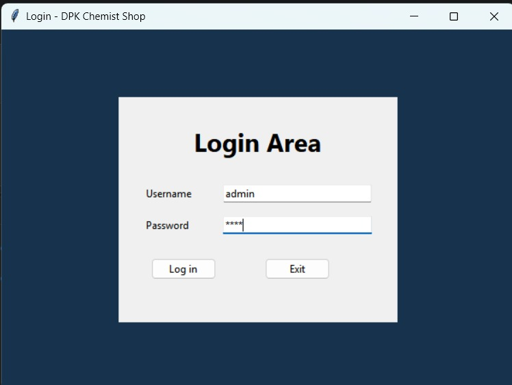
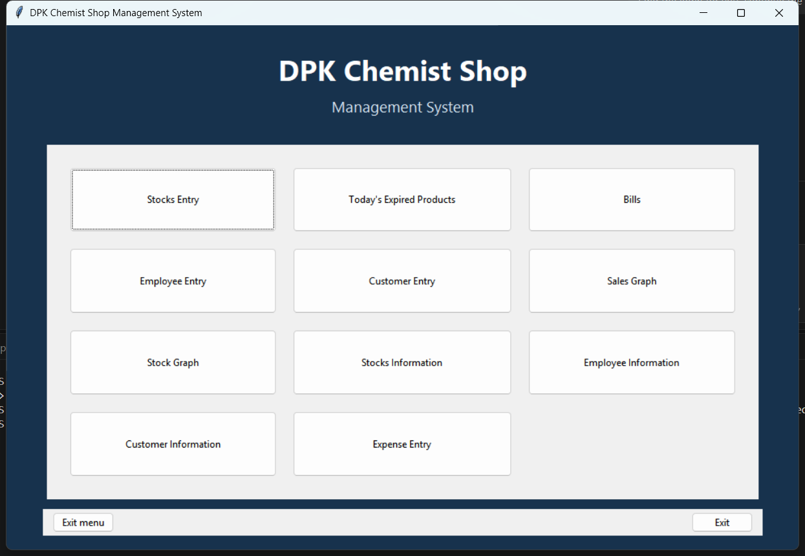

# DPK Chemist Shop Management System

A menu-driven desktop application for a small chemist shop, built with Python,
Tkinter, and MySQL. The project began as a Class 12 Informatics Practices
project and preserves its original screens and features, with additions for
saved billing and sales reporting.

> This is an educational project, not commercial pharmacy, medical, tax, or
> accounting software.

## Table of contents

- [Project overview](#project-overview)
- [Technologies](#technologies)
- [Features](#features)
- [Screenshots](#screenshots)
- [Project structure](#project-structure)
- [Prerequisites](#prerequisites)
- [Installation](#installation)
- [MySQL database setup](#mysql-database-setup)
- [Configuration](#configuration)
- [Run the application](#run-the-application)
- [Application screens and modules](#application-screens-and-modules)
- [Database tables](#database-tables)
- [Billing workflow and calculations](#billing-workflow-and-calculations)
- [Graphs and reporting](#graphs-and-reporting)
- [Demo data](#demo-data)
- [Tests](#tests)
- [Known limitations and project notes](#known-limitations-and-project-notes)
- [Future improvement ideas](#future-improvement-ideas)
- [Author and contributions](#author-and-contributions)

## Project overview

The application provides a graphical interface for managing medicine batches
and shop records. A user signs in, opens a feature from the main menu, and
works with Tkinter forms and tables. The application is designed to store
stock, employee, customer, bill, bill-item, and expense records in MySQL.
Matplotlib graph functions use those records.

**Verification status:** the Python environment and dependencies are
installed, and the seven helper tests pass. The local MySQL 8.0.46 connection
was verified, the previously absent `ip_project2022` database and its six
tables were initialized, and fictional demo records were imported once. The
application screens and application-driven CRUD/billing flows still need an
interactive GUI test.

The main workflow is:

1. Configure a local MySQL connection and application login.
2. Initialize the database using `database.sql`.
3. Sign in through the welcome/login screens.
4. Add medicine batches and maintain shop records.
5. Create a bill from available, unexpired stock.
6. Review saved records and graphs from the menu.

## Technologies

| Technology               | Use                                             |
| ------------------------ | ----------------------------------------------- |
| Python 3                 | Application logic, validation, and calculations |
| Tkinter / ttk            | Desktop screens, forms, buttons, and tables     |
| MySQL                    | Persistent application data                     |
| `mysql-connector-python` | Python-to-MySQL connection and queries          |
| Matplotlib               | Stock and monthly sales/profit-and-loss graphs  |

## Features

- Welcome screen and username/password login.
- Main menu with the original stock, expiry, bills, employee, customer, and
  graph options.
- Medicine stock add, update, delete, search, and list screens.
- Search stock by batch number or medicine name.
- Expired-medicine list for batches whose expiry date is today or earlier.
- Multi-item billing with optional customer name and phone.
- Stock availability and expiry checks before an item is billed.
- Saved bill receipts and stock quantity updates when a bill is completed.
- Employee add, update, delete, search, and list screens. The original fields,
  including the project’s `AdharNo` field, are retained.
- Customer add, update, delete, search, and list screens. The original fields
  for doctor, address, reason for visit, and receipt number are retained.
- Stock graph showing quantities grouped by medicine name.
- Monthly sales and estimated profit/loss graph based on saved bills, item
  costs, and recorded expenses.
- Expense entry, listing, and deletion to support the profit/loss graph.

## Screenshots

The project includes a small set of real captures from the running Tkinter
application. Additional UI screenshots can be added later once the remaining
screens are exercised on a local Windows machine.

| Screen                   | Capture status                                          |
| ------------------------ | ------------------------------------------------------- |
| Welcome                  | `screenshots/welcome.png` — pending capture             |
| Login                    |                   |
| Main dashboard/menu      |                  |
| Medicine stock listing   | `screenshots/medicine-stock.png` — pending capture      |
| Add/update medicine form | `screenshots/medicine-form.png` — pending capture       |
| Employee management      | `screenshots/employee-management.png` — pending capture |
| Customer management      | `screenshots/cust entry.jpeg`                           |
| Expired medicine listing | `screenshots/exp prods.jpeg` — pending capture          |
| Generated bill/receipt   | `screenshots/receipt.png` — pending capture             |
| Stock graph              | `screenshots/stock-graph.png` — pending capture         |
| Sales/profit-loss graph  | `screenshots/sales-report.png` — pending capture        |

## Project structure

```text
ipproject-main/
├── ip_project.py             # Tkinter application and database operations
├── database.sql              # Database and table initialization
├── demo_data.sql             # Optional fictional records for demonstration
├── db_config.example.py      # Example local database/login configuration
├── db_config.py              # Create locally; ignored by Git
├── requirements.txt          # Python package dependencies
├── .gitignore                # Excludes local configuration and generated files
├── README.md                 # Project documentation
├── tests/
│   └── test_helpers.py       # Validation and mocked database-helper tests
└── screenshots/
    └── README.md             # Instructions; no fabricated images
```

## Prerequisites

- Windows, macOS, or Linux.
- Python 3.10 or later, with Tkinter available. The project was syntax-checked
  and its helper tests were run using Python 3.15.2. The helper tests pass;
  GUI/database integration still needs a configured local run.
- MySQL Server 8.0 or a compatible MySQL installation. The setup SQL uses
  InnoDB, foreign keys, `DATE_FORMAT`, and MySQL date functions.
- A MySQL account allowed to create the project database during setup, and
  read/write access to it when running the application.
- Internet access to install the Python packages.

On some Linux distributions, Tkinter is installed separately from Python.
Install the distribution's Tkinter package if `import tkinter` fails.

On the Windows development computer used to prepare this repository, Python
3.15.2 with Tk support and MySQL Server 8.0.46 were detected. Their presence
was verified; the project database was initialized on that server. The
application's interactive GUI has not yet been manually exercised.

No image files or downloaded font assets are required. The welcome screen is
drawn with Tkinter widgets; the interface requests common system fonts.

## Installation

Open PowerShell in the project folder. The Python runtime detected on the
Windows computer used for this handoff is in the per-user Python Manager
directory. Find and check it with:

```powershell
$python = Join-Path $env:LOCALAPPDATA 'Python\pythoncore-3.15-64\python.exe'
if (-not (Test-Path $python)) { throw "Set `$python to your installed python.exe path." }
& $python --version
& $python -c "import tkinter; print('Tk', tkinter.TkVersion)"
```

If your Python installation is in a different directory, set `$python` to
that installation's `python.exe`. A standard Python installation added to
`PATH` can also be used by setting `$python = (Get-Command python).Source`.
Create a project-local virtual environment and install the listed packages:

```powershell
& $python -m venv .venv
.\.venv\Scripts\python.exe -m pip install -r requirements.txt
```

Activation is optional. If you prefer to activate the environment:

```powershell
.\.venv\Scripts\Activate.ps1
```

For macOS/Linux, activate the environment with:

```bash
source .venv/bin/activate
python -m pip install --upgrade pip
python -m pip install -r requirements.txt
```

## MySQL database setup

1. Check that MySQL Server is installed and running. On Windows, open
   **Services**, find the MySQL service (often named `MySQL80`), and verify its
   status is **Running**. If it is already running, do not reinstall it.
   PowerShell checks for the usual service and port are:

   ```powershell
   Get-Service MySQL80
   Test-NetConnection localhost -Port 3306
   ```

2. Open MySQL Workbench and connect to your local MySQL Server using an
   administrator account.
3. Open `database.sql` in Workbench (`File > Open SQL Script`), review it, and
   execute the script. It creates/selects `ip_project2022` and creates the
   tables if they do not already exist. It contains no `DROP` statements.
4. In a Workbench SQL tab, run `SELECT VERSION();` to check the server version.
5. If you have data from an older, manually created schema, back it up and
   check its columns before using this version. `CREATE TABLE IF NOT EXISTS`
   does not migrate or repair pre-existing tables.

The account used to initialize the database needs permission to create the
database and tables. The application account configured later needs permission
to read and modify the project tables.

## Configuration

The project intentionally does not include local credentials.

1. Copy the example configuration from the project folder:

   ```powershell
   if (-not (Test-Path .\db_config.py)) {
       Copy-Item .\db_config.example.py .\db_config.py
   } else {
       Write-Output "db_config.py already exists; leaving it unchanged."
   }
   ```

   On macOS/Linux:

   ```bash
   test -e db_config.py || cp db_config.example.py db_config.py
   ```

2. Edit `db_config.py`:
   - Set `DB_CONFIG` to your MySQL host, username, password, and database.
     The database name for this project is `ip_project2022`.
   - Set `LOGIN_USERNAME` and `LOGIN_PASSWORD` to the credentials for the
     application's login screen.
3. Keep `db_config.py` private. It is listed in `.gitignore`; do not commit it
   or share its contents.

The application login is a simple screen-level gate for this local project.
It is not a substitute for MySQL permissions or a production authentication
system. The login password is stored in the local configuration file, so
protect that file on your computer.

After editing `db_config.py`, verify the database connection without printing
or sharing the password:

```powershell
.\.venv\Scripts\python.exe -c "import mysql.connector; from db_config import DB_CONFIG; c = mysql.connector.connect(**DB_CONFIG, connection_timeout=5); print('Connected to MySQL', c.server_info, 'database:', c.database); c.close()"
```

The configured database must already exist, and the configured MySQL account
must have access to it. If this test reports an access-denied or connection
error, verify the host, port if added to `DB_CONFIG`, username, password, and
database, and ensure the MySQL service is running.

## Run the application

From the project folder, run with the virtual environment's interpreter:

```powershell
.\.venv\Scripts\python.exe .\ip_project.py
```

The welcome screen appears first, followed by the login form. Enter the
credentials configured in `db_config.py`. Database errors are shown when a
screen needs MySQL; check that the server is running, the schema was
initialized, and the connection settings are correct.

## Capturing screenshots

Use fictional demo records only. Do not include real Aadhaar numbers,
customer/patient details, passwords, or other private information in a
screenshot. `database.sql` and `demo_data.sql` target the database named
`ip_project2022`; do not run the demo script against an existing database
containing real data. If you need isolation, use a separate MySQL instance or
a separately prepared copy of the scripts configured for a test database.

Suggested capture order:

1. Start the application and press **Win + Shift + S** to capture the welcome
   screen before it advances.
2. Capture the login screen without entering or showing a password.
3. Sign in with the local demo login and capture the main menu.
4. Capture stock information with fictional medicine rows, then the stock
   entry form with fictional values.
5. Capture employee and customer screens with fictional records only. Take
   care to keep the Aadhaar field fictional.
6. Capture the expired-products list with a fictional batch whose expiry is
   today or earlier.
7. Open Bills, add fictional stock items, and capture the populated billing
   screen. Generate and save the bill, then capture its receipt.
8. Capture the stock graph and sales/profit-loss graph after adding demo data.
9. Save each Snipping Tool capture under its filename in `screenshots/`,
   then replace the matching placeholder row above with a relative image link.

Keep the application window large enough that labels and values are readable.
Avoid capturing other windows, desktop notifications, or credentials.

## Application screens and modules

The application is intentionally kept in one procedural Python file so its
callbacks and database operations remain approachable for a school project.

| Screen/module                | Purpose                                                                                             |
| ---------------------------- | --------------------------------------------------------------------------------------------------- |
| Welcome and login            | Show the shop welcome screen and check configured login credentials.                                |
| Main menu                    | Navigate to every management screen and graph; exit the menu back to login or exit the application. |
| Stocks Entry                 | Add, update, delete, search, clear, and view medicine batches.                                      |
| Today's Expired Products     | List every batch with an expiry date on or before today.                                            |
| Bills                        | Add one or more stock items, generate a receipt, save a bill, and update stock.                     |
| Employee Entry / Information | Maintain and view the original employee fields.                                                     |
| Customer Entry / Information | Maintain and view the original customer fields.                                                     |
| Stock Graph                  | Graph current stock quantity grouped by medicine.                                                   |
| Sales Graph                  | Graph monthly sales and estimated profit/loss from saved data.                                      |
| Expense Entry                | Record, list, and delete expenses used in the monthly graph.                                        |

Shared procedural helpers handle database connections, form validation, and
table display. Database values are passed as query parameters rather than
inserted into SQL strings.

## Database tables

All tables are created by `database.sql`.

| Table                 | Contents                                                                                                                                                       |
| --------------------- | -------------------------------------------------------------------------------------------------------------------------------------------------------------- |
| `stocks`              | Batch number, medicine name, quantity, selling price, cost price, manufacturer details, manufacturing date, and expiry date. `BatchNo` is the primary key.     |
| `staffinfo`           | Employee number, name, gender, age, designation, salary, Aadhaar number, and date of joining. `EmpNo` is the primary key.                                      |
| `customerinformation` | Customer ID, name, gender, age, phone, receipt number, doctor, address, and reason for visit. `ID` is the primary key.                                         |
| `bills`               | Unique receipt number, bill date, optional matching customer, customer-name/phone snapshot, subtotal, GST rate/amount, and total.                              |
| `bill_items`          | Medicine batch, name snapshot, quantity, sale-price and cost-price snapshots, and line total for each saved bill. Each item references a bill and stock batch. |
| `expenses`            | Expense date, category, amount, and description for the monthly profit/loss graph.                                                                             |

The employee and customer column names preserve the original project naming,
including `AdharNo` and `ReasonForVisit`. `billinfo` from the old script was
never created or written by the billing screen; saved sales and reports now
use `bills` and `bill_items`.

Relationships in the setup SQL:

- `bills.CustomerID` refers to `customerinformation.ID`; deleting a customer
  keeps the bill and clears its customer link.
- `bill_items.BillID` refers to `bills.BillID`; deleting a bill removes its
  item rows.
- `bill_items.BatchNo` refers to `stocks.BatchNo`; deleting a batch used by a
  saved bill is restricted so the bill history remains valid.

## Billing workflow and calculations

1. Enter optional customer name and phone.
2. Enter a batch number or an exact medicine name and the quantity.
3. If a medicine name has multiple batches, the application selects the
   earliest-expiring unexpired batch with enough stock.
4. Add items to the bill. The displayed price comes from the stock record.
5. Generate the bill. The application checks stock again, saves the bill and
   item rows, and reduces inventory in the same database transaction.
6. A successful bill displays its receipt number and itemized totals. If a
   database write fails, the transaction is rolled back.

For each bill:

```text
Line total = quantity × selling price
Subtotal   = sum of line totals
GST        = subtotal × 5%
Bill total = subtotal + GST
```

The 5% rate preserves the original project’s demonstration calculation. It is
not a statement of current tax requirements. Profit/loss reporting uses sales
before GST, the cost price saved for each sold item, and expenses entered in
the application; it is an estimate, not formal accounting.

## Graphs and reporting

- **Stock Graph:** groups stock rows with the same medicine name and plots the
  sum of their available quantities.
- **Sales Graph:** groups saved bills and expenses by year and month. It plots
  sales before GST and estimated profit/loss. Estimated profit/loss is sales
  less the saved cost of sold items and recorded expenses.

The graph uses saved database records. An empty database has no graph data;
the optional demo script can add sample records.

## Demo data

After initializing the database, open `demo_data.sql` in MySQL Workbench and
execute it once. The script adds fictional stock, employee,
customer, sale, and expense records to demonstrate the forms and graphs. Do
not use real personal information in demo data. The demo sale starts with
stock quantities already reflecting that example sale. Avoid running the
script repeatedly because each run may add another example expense.

The local database prepared for this handoff already contains the demo rows.
Do not import `demo_data.sql` again unless you intentionally want another
example expense.

## Tests

Run the helper tests from the project folder after installing the requirements:

```powershell
.\.venv\Scripts\python.exe -m unittest discover -s tests
```

The tests cover currency/date validation and database helper commit, rollback,
and connection-cleanup behavior using a mock connection. They do not replace a
manual end-to-end run against a configured MySQL server.

## Known limitations and project notes

- This is a local, single-user desktop project, not a multi-user or
  commercial pharmacy system.
- The configured login is a basic UI gate; the MySQL account controls actual
  database access.
- The GST rate is fixed at 5% for the original educational calculation and
  should not be used as tax guidance.
- Profit/loss is an estimate based on entered cost prices and recorded
  expenses. It does not include every possible business cost.
- Deleting a stock batch already referenced by a saved bill is restricted so
  that the bill history remains valid.
- The application displays a receipt in a window; printing and PDF export are
  not included.
- Employee Aadhaar and customer/medical-related fields are retained for
  continuity with the original project. Use fictional data for demonstrations
  and protect any real data appropriately.
- The database initialization script creates missing tables but does not
  migrate an older schema.
- The included automated tests cover validation and database helpers using
  mocked connections. The schema and demo-data scripts were run on the local
  MySQL Server, but interactive GUI behavior and application-driven
  transactions still need a manual end-to-end test.
- Genuine screenshots should be added after the project is configured and
  launched; the screenshot entries above are placeholders.

## Future improvement ideas

- Add a safe database migration procedure for older installations.
- Add bill-history search and receipt re-opening.
- Add a low-stock report and optional CSV export.
- Add clearer selection controls for medicines with several eligible batches.
- Add optional integration tests against a disposable MySQL database.
- Capture and add genuine screenshots for the README.

## Author and contributions

- **Author:** [Your Name]
- **Class / course:** Class 12 Informatics Practices
- **School:** [Your School]
- **Contact:** [Your Email or GitHub Profile]

Contributions and suggestions are welcome. Please describe the issue or
proposed change clearly and keep improvements suitable for the project’s
student-level scope.
